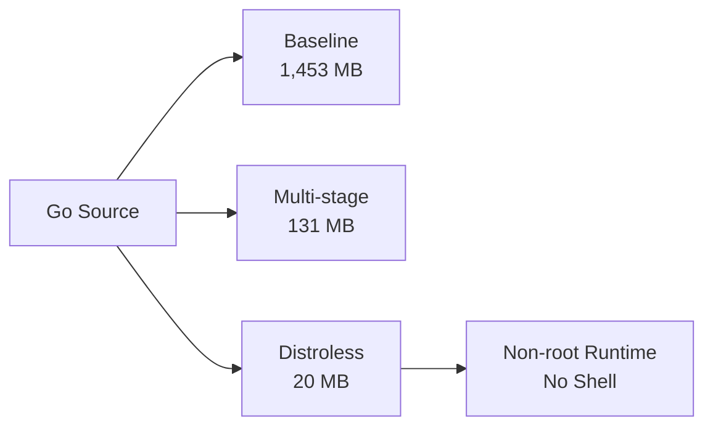

<div align="center">

# 🔭 ContainerScope
**See what your container really carries.**
Compare Docker build strategies — size, dependencies & security — with real numbers.

[[Go](https://img.shields.io/badge/Go-1.27.4-00ADD8?logo=go&logoColor=white)](https://go.dev)
[[Docker](https://img.shields.io/badge/Docker-Multi--stage-2496ED?logo=docker&logoColor=white)](https://www.docker.com)
[[Distroless](https://img.shields.io/badge/Distroless-nonroot-4285F4?logo=google&logoColor=white)](https://github.com/GoogleContainerTools/distroless)
[[License](https://img.shields.io/badge/License-MIT-green)](LICENSE)

[🚀 Quick Start](#-quick-start) • [📊 Results](#-results) • [🛡 Security](#-security) • [⚙ App](#-application)
</div>

---
## ⚡ What is ContainerScope?
A Go project that proves one thing: **how you build matters more than what you build.** Same app. Three Dockerfiles. Dramatically different outcomes.
| Strategy | Idea |
| :--- | :--- |
| **1. Baseline** | Single-stage build — everything ships |
| **2. Multi-stage** | Build here, run there — only the binary ships |
| **3. Distroless** | Minimal runtime — no shell, no package manager, non-root |
> Measured locally on **November 21, 2026** via `docker image inspect`. Local sizes, not compressed registry download sizes.
---
## 📊 Results
<div align="center">

### 🏆 98.64% smaller
**Baseline → Distroless** &nbsp;|&nbsp; `1,453.33 MB` → `19.75 MB`
</div>

| Build Strategy | Base Image | Image Size |
| :--- | :--- | ---: |
| Baseline | `golang:1.27.4` | 1,453.33 MB |
| Multi-stage | `debian:13-slim` | 130.68 MB |
| Distroless | `gcr.io/distroless/static-debian13:nonroot` | **19.75 MB** |
| Reduction | Saving |
| :--- | ---: |
| Baseline → Multi-stage | **91.01%** |
| Multi-stage → Distroless | **84.88%** |
| Baseline → Distroless | **98.64%** |
---
## 🛡 Security
Smaller images expose less.
| Security Aspect | Baseline | Multi-stage | Distroless |
| :--- | :---: | :---: | :---: |
| Build tools in runtime | Yes | No | No |
| Shell available | Yes | Yes | No |
| Package manager | Yes | Yes | No |
| Non-root configured | No | No | **Yes** |
| Runtime footprint | Largest | Reduced | **Smallest** |
- **Multi-stage:** compiler & build tools never reach runtime. Fewer dependencies = fewer things to exploit.
- **Distroless:** strips shell, package manager & utilities. No shell = harder lateral movement after compromise.
- **Non-root:** a breakout as `nonroot` is far less damaging than as `root`.
- **Not zero-risk:** Distroless reduces attack surface, it does not guarantee zero vulnerabilities.
- **Still required:** vulnerability scanning, dependency updates & runtime hardening.
---
## 🐳 Build Flow

---
## 🚀 Quick Start
### Clone
```bash
git clone https://github.com/anuzdevops/go-distroless-image-optimization.git
cd go-distroless-image-optimization
```
### Build
```bash
docker build -f Dockerfile.baseline -t containerscope:baseline .
docker build -f Dockerfile.multistage -t containerscope:multistage .
docker build -f Dockerfile.distroless -t containerscope:distroless .
```
### Generate Metrics
```bash
chmod +x scripts/generate-image-metrics.sh
./scripts/generate-image-metrics.sh
```
### Run Distroless
```bash
docker run --rm --name containerscope \
  -p 8080:8080 \
  -e PORT=8080 \
  -e METRICS_FILE=/image-metrics.json \
  -v "$PWD/image-metrics.json:/image-metrics.json:ro" \
  containerscope:distroless
```
### Test
```bash
curl http://localhost:8080/health
curl http://localhost:8080/api/metrics
```
---
## ⚙ Application
**Includes:** Go HTTP server • Dashboard • Health endpoint • Metrics API • Embedded static assets • Graceful shutdown • Image metrics via Docker inspection
| Endpoint | Purpose |
| :--- | :--- |
| `/` | Dashboard |
| `/health` | Health check |
| `/api/metrics` | Image comparison JSON |
| `/static/` | Static assets |
| Variable | Default |
| :--- | :--- |
| `PORT` | `8080` |
| `METRICS_FILE` | `image-metrics.json` |
> **Note:** Multi-stage & Distroless copy only the compiled binary. Mount `image-metrics.json` separately if you need `/api/metrics` to work.
<details>
<summary><b>🧰 Stack</b></summary>
Go 1.27.4 • Docker • Docker Multi-stage Builds • Debian 13 Slim • Google Distroless • Shell scripting • JSON-based image metrics
</details>

---
<div align="center">

**Build lean. Ship less. Secure more.**
⭐ Star this repo if it helped you rethink your Dockerfile.
</div>
